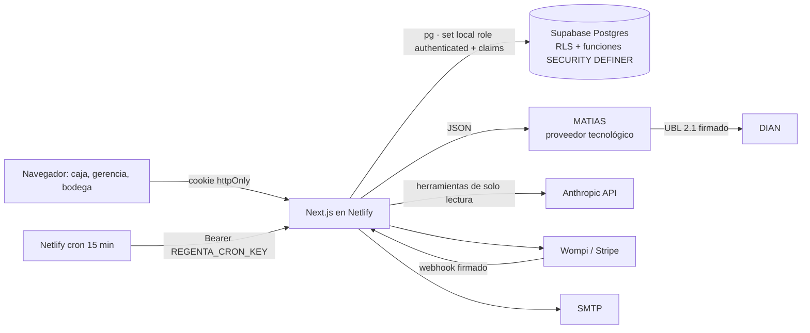

# 01 · Arquitectura actual

Regenta (regenta.pro) es un SaaS multiempresa para droguerías colombianas: caja POS, factura electrónica DIAN, inventario por lote y vencimiento, compras, cartera, control especial (Anexo 13) y Regenta IA.

## Stack

| Capa | Tecnología | Dónde |
|---|---|---|
| Web y API | Next.js 15 (App Router), React 19, TypeScript, Tailwind | `src/app` (102 páginas, 116 archivos de rutas API = 160 combinaciones método+ruta) |
| Base de datos | PostgreSQL (Supabase en producción; Postgres 16 local para pruebas) con `pg` | `db/migrations` (54 archivos de migración; el último `051_auditoria_correcciones.sql`) |
| Seguridad de datos | RLS en las 72 tablas (`rol_en()`, `mis_empresas()`); escrituras solo por funciones `SECURITY DEFINER` con `search_path` fijo; tablas inmutables (`no_modificar()`) | `db/migrations/002_seguridad.sql` y siguientes |
| Sesión | JWT HS256 (`jose`) en cookie `httpOnly` `regenta_sesion` (12 h; 1 h en modo soporte); consola con cookie `regenta_admin` y TOTP opcional | `src/lib/sesion.ts`, `src/lib/admin.ts`, `src/lib/totp.ts` |
| Validación | zod 3.25 en las rutas que escriben | `src/app/api/**` |
| Facturación DIAN | Proveedor tecnológico **MATIAS** (API JSON → MATIAS arma el UBL 2.1, firma y transmite; devuelve CUFE/CUDE, QR, XML/PDF) | `src/lib/dian/*` |
| Pagos de suscripción | Wompi (Colombia) y Stripe; webhooks firmados + reconsulta del pago | `src/lib/pagos*.ts`, `src/app/api/pagos/*` |
| IA | API de Anthropic, modelo por variable (`REGENTA_IA_MODELO`); 10 herramientas de solo lectura | `src/lib/ia/*`, `src/app/api/ia` |
| Correo | SMTP (nodemailer) con cola en base | `src/lib/correo/*` |
| Tareas programadas | Netlify Scheduled Function cada 15 min → `POST /api/tareas` (correos, cola DIAN, alertas INVIMA cada 6 h) | `netlify/functions/tareas.mjs` |
| Despliegue | Netlify (adaptador oficial de Next) | `netlify.toml`, `tasks/despliegue.md` |

## Diagrama

## Modelo de seguridad

- Cada petición corre como el usuario: `comoUsuario` abre transacción, fija `request.jwt.claims` y `set local role authenticated`; la RLS decide qué filas ve. `sinRLS` solo se usa con filtro explícito por la empresa de la sesión (verificado en la auditoría, ver 06).
- Las reglas de negocio de dinero e inventario están en la base (FEFO, idempotencia por `idem_key`, numeración con bloqueos, existencias no negativas, inmutabilidad de ventas y movimientos).
- Roles: `dueno`, `admin`, `cajero`, `bodeguero`, `vendedor` (+ superadministrador en la consola). Permisos en servidor: `puede.*` (`src/lib/sesion.ts`) y en cada función SQL.

## Variables de entorno (nombres; los valores no se registran)

`DATABASE_URL`, `DATABASE_CA`, `REGENTA_SESSION_SECRET`, `REGENTA_CRON_KEY`, `REGENTA_URL`, `REGENTA_DIAN`, `MATIAS_URL`, `MATIAS_TOKEN`, `ANTHROPIC_API_KEY`, `REGENTA_IA_MODELO`, `REGENTA_IA_MODELO_FACTURAS`, `REGENTA_IA_URL`, `WOMPI_*`, `STRIPE_*`, `SMTP_*`, `REGENTA_ADMIN_DOS_PASOS`, `REGENTA_CABECERA_IP`, `REGENTA_DEMO`, `REGENTA_QR_*`.

## Pruebas existentes

- `node --test`: 16 archivos de unidad y de base de datos (ahora 18; 184 pruebas).
- `tests/e2e/*.mjs`: 45 suites con Playwright contra servidor y base reales (43 antes de la auditoría + 2 nuevas), incluida `endpoints.mjs` (2.699 comprobaciones de permisos y datos rotos), `auditoria.mjs` (358 pantallas) y `dispositivos.mjs` (748 pantallas en 10 equipos).
- Simuladores locales de Anthropic, MATIAS, Wompi y Stripe para no tocar servicios reales.
